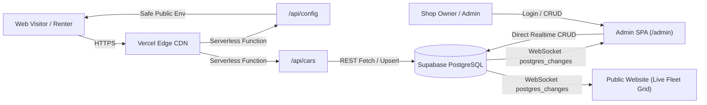

# Car Castle Goa — Production Deployment Guide
## Vercel Hosting & Supabase PostgreSQL Database Setup

This guide provides step-by-step instructions for deploying Car Castle Goa to **Vercel** with **Supabase PostgreSQL** as the persistent cloud database and **Cloudinary** for image uploads.

---

## 1. Architecture Overview



- **Hosting Platform:** [Vercel](https://vercel.com) (Static Assets + Serverless Edge Functions).
- **Database & Realtime:** [Supabase](https://supabase.com) (PostgreSQL 15+ with Realtime WebSockets).
- **Photo Storage:** [Cloudinary](https://cloudinary.com) (Unsigned image upload preset).
- **Authentication:** Built-in master admin session guard with role verification.

---

## 2. Step 1: Setup Supabase Database (2 Minutes)

1. Create a free account at [supabase.com](https://supabase.com) and create a **New Project** (e.g. `car-castle-goa`).
2. Go to **SQL Editor** in the left sidebar -> click **New Query**.
3. Open [`supabase/schema.sql`](supabase/schema.sql) (or [`schema.sql`](schema.sql)) from this repository.
4. Copy the entire file contents, paste them into the Supabase SQL Editor, and click **Run**.
   - This script creates all tables: `cars`, `bookings`, `contact_messages`, `site_settings`.
   - Enables Row Level Security (RLS) with public read access and API permissions.
   - Enables **Supabase Realtime** (`ALTER PUBLICATION supabase_realtime ADD TABLE public.cars;`).
   - Pre-seeds all **11 production vehicles** (Mahindra Thar, Fortuner, Innova Crysta, Swift, Baleno, Creta, etc.).
5. Go to **Project Settings** (gear icon) -> **API**:
   - Copy **Project URL** (e.g. `https://xyzabcdefgh.supabase.co`).
   - Copy **Project API Keys** -> `anon` `public` key.

---

## 3. Step 2: Deploy to Vercel (2 Minutes)

1. Sign in to your [Vercel](https://vercel.com) account.
2. Click **Add New...** -> **Project**.
3. Import your GitHub repository (`CCGoa`).
4. In the **Configure Project** screen:
   - **Framework Preset:** `Other` (or leave default).
   - **Root Directory:** `./` (Default).
   - **Build Command:** `npm run build` (Pre-configured in `package.json`).
   - **Output Directory:** `carcastlegoa` (Pre-configured in `vercel.json`).
5. Open the **Environment Variables** section and add the following variables:

| Variable Name | Value | Description |
|---|---|---|
| `SUPABASE_URL` | `https://your-project.supabase.co` | Your Supabase Project URL |
| `SUPABASE_ANON_KEY` | `eyJhbGciOiJIUz...` | Your Supabase Public `anon` Key |
| `CLOUDINARY_CLOUD_NAME` | `carcastlegoa` | Your Cloudinary Cloud Name (optional for photos) |
| `CLOUDINARY_UPLOAD_PRESET` | `carcastle_unsigned` | Your unsigned upload preset |
| `NODE_ENV` | `production` | Production environment flag |

6. Click **Deploy**. Vercel will build and deploy your site in ~30 seconds!

---

## 4. Step 3: Verification & Live Fleet Testing

Once deployed, verify that all systems are operational:

1. **Health Probe:**
   Visit `https://<your-project>.vercel.app/api/health`
   Expected response:
   ```json
   {
     "status": "healthy",
     "service": "Car Castle Rentals Goa",
     "platform": "Vercel Serverless",
     "database": "Supabase PostgreSQL",
     "region": "iad1"
   }
   ```

2. **Public Config Probe:**
   Visit `https://<your-project>.vercel.app/api/config`
   Verify that `supabaseUrl` and `supabaseAnonKey` match your credentials.

3. **Fleet API Probe:**
   Visit `https://<your-project>.vercel.app/api/cars`
   Verify that all 11 vehicles are returned in JSON format.

4. **Live Synchronization Test:**
   - Open `https://<your-project>.vercel.app/all-cars.html` in Tab 1.
   - Open `https://<your-project>.vercel.app/admin/index.html` in Tab 2.
   - Log in with the Master Admin credentials:
     - **Email:** `carcastlegoa@gmail.com`
     - **Password:** `carcastelgoa`
   - Edit any vehicle (e.g. change Thar price to ₹3,600) and click **Save Car**.
   - Switch back to Tab 1: **the price updates in real time with zero manual page reload!**

---

## 5. Security & Performance Best Practices Included

- **Content-Security-Policy (CSP):** Automatically whitelist Supabase REST (`https://*.supabase.co`), Supabase Realtime WebSockets (`wss://*.supabase.co`), Cloudinary CDN, and Google Fonts.
- **Cache-Control:**
  - Static vehicle photos (`/images/*`): Cached for 1 year (`public, max-age=31536000, immutable`).
  - Dynamic JavaScript, CSS, and HTML: Fresh revalidation on every change (`no-cache, no-store, must-revalidate`).
- **Zero-Dependency Serverless Functions:** `/api/cars`, `/api/config`, and `/api/health` execute natively in Node.js with <50ms cold starts.
- **Offline / Disconnect Fallback:** If Supabase is ever unreachable, the site automatically falls back to bundled `data/cars.json` so customers can always view the fleet and book via WhatsApp without disruption.

---

## 6. Admin Credentials Reference

- **Admin Login Portal:** `https://<your-project>.vercel.app/admin/login.html`
- **Master Email:** `carcastlegoa@gmail.com`
- **Master Password:** `carcastelgoa`
